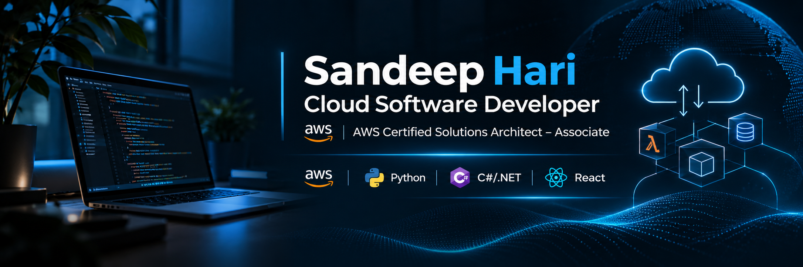

  
  
  

## About me

I'm an Application Development graduate and **AWS Certified Solutions Architect – Associate**, currently completing the **Nedbank–BankSETA Cloud Learnership**. I build cloud-based systems and full-stack applications using AWS, Azure, Python, C#, ASP.NET Core and React.

- **Cloud:** AWS serverless architecture, integrations, security and monitoring
- **Development:** Backend systems, REST APIs and full-stack web applications
- **Location:** Johannesburg, South Africa
- **Focus:** Junior cloud engineering and software development opportunities

## Technical skills

**Languages**

    

**Frameworks & Frontend**

    

**Cloud & Databases**

     

**Tools**

  

## Featured work

### [FinTrust | Transaction Insights & Risk Monitoring](https://github.com/SandeepHarii/fintrust-risk-system)

**Solo AWS capstone · October 2026 · 2nd place (90/100)**

Built a serverless transaction-processing system that validates CSV uploads, quarantines invalid records, detects high-amount, high-velocity and cross-border risk, and displays results through a React dashboard.

**Stack:** AWS Lambda, S3, SQS FIFO, Step Functions, API Gateway, RDS PostgreSQL, DynamoDB, SES, CloudWatch, Python and React.

The original AWS demo environment is shut down to control costs. Code, architecture and test evidence remain in the repository.

[Explore FinTrust](https://github.com/SandeepHarii/fintrust-risk-system)

### Other projects

| Project | What it does | Technologies |
|---|---|---|
| [Agri Energy Connect](https://github.com/SandeepHarii/Agri-Energy-Connect) | Connects farmers with sustainable technology providers using role-based access and product listings. [Demo](https://youtu.be/H0o7uScgHO8) | ASP.NET Core MVC, EF Core, SQLite, Bootstrap |
| [Contract Monthly Claim System](https://github.com/SandeepHarii/Contract-Monthly-Claim-System) | Streamlines claim submissions, approvals, reporting and notifications. [Demo](https://youtu.be/Bmcx4-nGoCY) | ASP.NET Core MVC, EF Core, SQL Server, SSRS |
| [KhumaloCraft Emporium](https://github.com/SandeepHarii/KhumaloCraft-Emporium) | Cloud-hosted e-commerce application with catalogue, order management, search and automation. | ASP.NET Core, Azure App Service, Azure SQL, Durable Functions |

## Connect

**[Portfolio website](https://sandeepharii.github.io/Sandeep-Hari-CV/)** · **[LinkedIn](https://www.linkedin.com/in/sandeep-harii/)** · **[Email](mailto:Sandeep.Hari19@gmail.com)**
